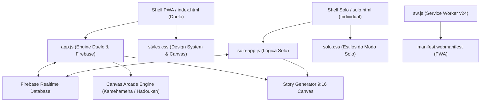
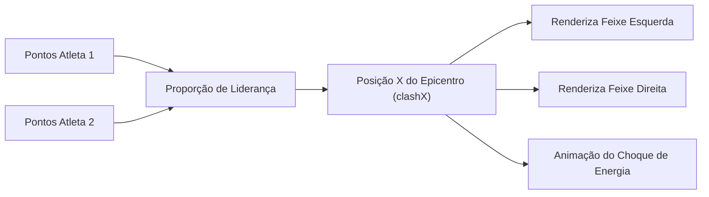

# 📋 SHEETMASTER · REP CLUB (R+)
> **Documento Mestre de Especificação, Arquitetura, Lógica de Negócio e Histórico de Decisões do Aplicativo.**

---

## 1. Identificação e Metadados do Projeto

| Atributo | Detalhe |
| :--- | :--- |
| **Nome da Aplicação** | **Rep Club (R+)** |
| **Repositório GitHub** | [`https://github.com/matheushscastro-ai/rep-club`](https://github.com/matheushscastro-ai/rep-club) |
| **Branch Ativa / Produção** | `main` |
| **Live URL (PWA)** | [`https://matheushscastro-ai.github.io/rep-club/`](https://matheushscastro-ai.github.io/rep-club/) |
| **Versão Atual** | `v2.8.6` (Service Worker `rep-club-pwa-v25`) |
| **Stack Tecnológica** | HTML5 Semântico, CSS3 Moderno, JavaScript Vanilla (ES6+), Web Audio API, Canvas 2D API |
| **Backend & Sync** | Firebase Realtime Database (RTDB), Firebase Authentication (Anônimo + Email/UID) |
| **Distribuição & Plataforma** | PWA (Progressive Web App) instalável em iOS, Android, MacOS e Windows com suporte offline |

---

## 2. Visão Geral e Proposta de Valor

O **Rep Club** é uma plataforma gamificada de consistência física criada para transformar o hábito de treinar em uma experiência competitiva empolgante entre amigos.

### 2.1 Pilares Centrais
1. **Duelo em Tempo Real (Modo Duelo):** Dois atletas competem durante um período (ex.: 30 a 90 dias) disputando um prêmio acordado (ex.: "Um rodízio de comida japonesa"). A pontuação acumulada controla uma arena arcade retrô (Goku vs Cell ou Ryu vs Ken) onde o choque de poderes reflete dinamicamente a liderança.
2. **Modo Solo (Meu Treino):** Espaço para registro e acompanhamento de treinos individuais, builder de fichas semanais (AB, ABC, ABCD, ABCDE), rastreamento de sobrecarga progressiva, volume de carga acumulada e gráficos de evolução.
3. **Gamificação Realista:** Sistema de Badges/Conquistas desbloqueáveis (horários de treino, consistência em finais de semana, tonelagem levantada) e gerador de cartões verticais em formato 9:16 prontos para postagem no Instagram Stories.
4. **Execução Prática na Academia e Tatame:** Cronômetro inline preenchível logo após a última série de cada exercício com alertas sonoros e vibração, preenchimento de sobrecarga com um clique e compressão inteligente de fotos antes de envio.

---

## 3. Arquitetura de Arquivos e Código



### 3.1 Inventário dos Arquivos Principais

* **`index.html`**: Estrutura do Modo Duelo. Contém o placar Arcade Kamehameha, Raio-X comparativo, gráfico semanal, seletor de cenários retrô, modal de registro de treino com foto e seletor de múltiplos desafios.
* **`app.js`**: Núcleo do Modo Duelo (~5.800 linhas). Controla:
  * Inicialização e autenticação anônima/ativa no Firebase.
  * Sincronização bidirecional do Realtime Database com listener `.on("value")`.
  * Algoritmo de autoria imutável (`resolvePlayerForWorkout`) e rotina de autocura (`healWorkouts`).
  * Engine gráfica do Canvas Arcade (física dos feixes, colisão, epicentro e sprites).
  * Renderizador de Stories 9:16 do duelo.
  * Cronômetro de descanso inline e global com Web Audio API.
* **`styles.css`**: Design system visual. Estilo arcade cyberpunk, tipografia condensada (`Barlow Condensed`) e corpo geométrico (`DM Sans`), modais nativos `<dialog>`, badges, gráficos e responsividade mobile-first.
* **`solo.html`**: Aplicação independente para acompanhamento individual de musculação, jiu-jitsu e cardio.
* **`solo-app.js`**: Gerenciador de fichas customizadas do usuário, cálculo de volume de treino, gráfico de progressão de carga por exercício e gerador de stories solo.
* **`solo.css`**: Regras visuais específicas para o modo individual.
* **`sw.js`**: Service Worker PWA com cache estático (`ASSETS_TO_CACHE`) e atualização forçada por chave de cache (`rep-club-pwa-v24`).
* **`manifest.webmanifest`**: Configuração de instalação nativa (ícones 192px/512px, tema `#191a16`, modo standalone).

---

## 4. Modelos de Dados e Schemas (JSON)

### 4.1 Objeto Treino (`Workout`)
```json
{
  "id": "uuid-v4-string",
  "challengeId": "challenge-1",
  "userId": "firebase-auth-uid-permanente",
  "userEmail": "atleta@exemplo.com",
  "userName": "Matheus",
  "owner": "player-1",
  "category": "strength", 
  "name": "Treino A - Peito e Tríceps",
  "date": "2026-10-18",
  "createdAt": "2026-10-18T14:32:00.000Z",
  "duration": 60,
  "effort": 8,
  "points": 18,
  "basePoints": 9,
  "qualityPoints": 9,
  "trainingVolume": 14250,
  "photo": "data:image/webp;base64,...",
  "comments": "Supino reto subiu com facilidade hoje.",
  "exercises": [
    {
      "name": "Supino Reto com Barra",
      "plannedSets": 4,
      "minReps": 8,
      "maxReps": 10,
      "loadFactor": 1,
      "requiresLoad": true,
      "restDuration": 90,
      "sets": [
        { "done": true, "reps": 10, "load": 80 },
        { "done": true, "reps": 9, "load": 80 },
        { "done": true, "reps": 8, "load": 80 },
        { "done": true, "reps": 8, "load": 80 }
      ]
    }
  ]
}
```

### 4.2 Objeto Duelo (`Challenge`)
```json
{
  "id": "challenge-uuid",
  "title": "Duelo dos Monstros 2026",
  "prize": "Jantar no Rodízio Japonês",
  "period": {
    "start": "2026-10-01",
    "end": "2026-11-15"
  },
  "createdBy": "user-uid-criador",
  "creatorEmail": "criador@exemplo.com",
  "scenario": "sf_ryu_ken",
  "players": [
    {
      "id": "player-1",
      "uid": "uid-matheus",
      "email": "matheus@exemplo.com",
      "name": "Matheus",
      "avatar": "M",
      "color": "#a9c92a"
    },
    {
      "id": "player-2",
      "uid": "uid-rival",
      "email": "rival@exemplo.com",
      "name": "Pedro",
      "avatar": "P",
      "color": "#e0533c"
    }
  ]
}
```

---

## 5. Lógica de Pontuação e Regras de Negócio

### 5.1 Fórmulas de Pontos por Modalidade
A pontuação é composta por uma pontuação base somada a pontos de qualidade:
$$\text{Pontos Totais} = \text{basePoints} + \text{qualityPoints}$$

| Modalidade | Base (`basePoints`) | Esforço Máx | Critérios de Qualidade |
| :--- | :---: | :---: | :--- |
| **Musculação (`strength`)** | 9 pts | 7 pts | $\text{Execução de Séries} + \text{Nível de Esforço (1-10)} + \text{Progressão de Carga}$ |
| **Jiu-jitsu (`bjj`)** | 11 pts | 7 pts | Referência de 60 min de tatame ($\pm 4\text{ pts}$) $+ \text{Esforço (1-10)}$ |
| **Cardio (`cardio`)** | 8 pts | 8 pts | Referência de 30 min de cardio ($\pm 4\text{ pts}$) $+ \text{Esforço (1-10)}$ |

### 5.2 Algoritmo de Trava e Resolução de Autoria (`resolvePlayerForWorkout`)
Para impedir que treinos invertam de atleta quando o app sincroniza entre diferentes celulares, foi implementada a resolução estrita:
1. **UID Permanente:** Compara `workout.userId` com o `uid` ou `id` dos atletas do desafio.
2. **E-mail do Atleta:** Compara `workout.userEmail` com `player.email`.
3. **Nome do Atleta:** Compara `workout.userName` com `player.name`.
4. **Fallback:** Apenas se nenhuma das 3 chaves for encontrada, utiliza o `workout.owner`.

### 5.3 Cura Automática de Treinos Legados (`healWorkouts`)
Ao carregar dados do LocalStorage ou do Firebase, a rotina analisa treinos legados sem `userId` e restaura as informações corretas de autor com base no e-mail ou no contexto de quem adicionou.

---

## 6. Engine Gráfica Arcade (Canvas 2D)

O placar do duelo utiliza renderização contínua em `<canvas id="kamehameha-canvas">` (resolução base `760x170` escalada proporcionalmente via CSS).



### 6.1 Cenários Retrô Disponíveis
1. **🐉 Goku vs Cell (`dbz_goku_cell`)**:
   - Atleta 1: Goku SSJ carregando o Kamehameha (`assets/dbz/goku_ssj.png`) com feixe azul/celeste.
   - Atleta 2: Cell Perfeito disparando o Kamehameha Solar (`assets/dbz/cell_perfect.png`) com feixe amarelo.
   - Epicentro: Efeito de choque de plasma alternado (`clash_epicenter.png` / `clash_epicenter_b.png`).
2. **🥊 Ryu vs Ken (`sf_ryu_ken`)**:
   - Atleta 1: Ryu com kimono branco, luvas e faixa vermelha disparando Hadouken azul (`assets/sf/ryu.png`, `ryu_beam.png`, `ryu_blast.png`).
   - Atleta 2: Ken Masters com cabelos loiros longos e kimono vermelho disparando o Shakunetsu Hadouken de fogo alaranjado (`assets/sf/ken.png`, `ken_beam.png`, `ken_blast.png`).
   - Alinhamento vertical exato das mãos e feixes em `y = 76px`.

---

## 7. Catálogo Completo de Badges & Conquistas

O sistema avalia dinamicamente os treinos de cada atleta e desbloqueia medalhas exclusivas com fanfarra sonoro-háptica:

| ID | Ícone | Nome | Critério de Desbloqueio |
| :--- | :---: | :--- | :--- |
| `monstro-madrugada` | 🌅 | **Monstro da Madrugada** | Treino concluído antes das 07:00 da manhã |
| `coruja-noturna` | 🌙 | **Coruja Noturna** | Treino concluído após as 21:00 da noite |
| `sequencia-ferro` | 🔥 | **Sequência de Ferro** | 7 dias consecutivos com pelo menos 1 treino |
| `guerreiro-fds` | ⚔️ | **Guerreiro de Fim de Semana** | Treinou no sábado e no domingo do mesmo fim de semana |
| `clube-100k` | 🏋️‍♂️ | **Clube dos 100k** | Acumulou mais de 100.000 kg (100 toneladas) de volume |
| `centuriao` | 💯 | **Centurião dos Treinos** | Atingiu 100 ou mais pontos no duelo atual |
| `mestre-trilhas` | 🥋 | **Mestre Multidisciplinar** | Registrou treinos nas 3 modalidades (Musculação, Jiu e Cardio) |
| `virada-epica` | ⚡ | **Virada Épica** | Ultrapassou o adversário e assumiu a liderança do duelo |

---

## 8. Sistema de Execução de Treino & Cronômetro

### 8.1 Cronômetro Inline por Exercício
* Localizado **imediatamente após a última série** de cada bloco de exercício (`.exercise-rest-bar`).
* Campo de tempo **livremente preenchível** (ex.: 45s, 60s, 90s, 120s), com suporte à tecla `Enter`.
* Botão de Play com contagem regressiva em tempo real (`[ ⏹ 00:59 ]`), animação de pulso verde e clique para pausar/zerar.
* **Auto-disparo inteligente:** Marcar o checkbox de uma série finalizada (`SÉRIE X`) dispara automaticamente o cronômetro com o tempo configurado para aquele exercício.

### 8.2 Feedback Sensorial (Web Audio API + Vibração)
* **Bip de Contagem Regressiva:** Bips sutis nos 3 segundos finais (3, 2, 1).
* **Alerta de Finalização:** Tom duplo com osciladores de áudio sintetizados nativamente (sem dependência de arquivos MP3 externos).
* **Vibração Háptica:** `navigator.vibrate([150, 80, 150])` no celular.

### 8.3 Layout e Rolagem Contínua
* O modal de registro de treino possui **rolagem contínua e única** (`overflow: auto` no `<dialog>`), sem sub-scrolls presos nos exercícios.
* O cronômetro flutuante global (`.rest-dock`) permanece fixado na barra inferior do aplicativo fora do modal.

---

## 9. Compressão Automática de Fotos de Treino

Para permitir upload rápido em 4G/5G e poupar banco de dados:
* As fotos tiradas via câmera (`capture="environment"`) ou galeria passam por um redimensionador no `<canvas>` cliente antes do salvamento.
* Redimensiona para resolução máxima de `1200px` mantendo proporção.
* Converte para formato `image/webp` (com fallback para `image/jpeg`) com qualidade `0.8`.
* Reduz arquivos típicos de câmeras modernas de **5MB–12MB para aproximadamente 150KB–300KB**.

---

## 10. Regras de Segurança do Firebase (`database.rules.json`)

Para blindar o banco contra sobrescritas indevidas de treinos entre competidores:
```json
{
  "rules": {
    "rep-club": {
      "workouts": {
        ".read": true,
        "$workoutId": {
          ".write": "auth != null && (!data.exists() || data.child('user_id').val() === auth.uid || newData.child('user_id').val() === auth.uid || data.child('userId').val() === auth.uid || newData.child('userId').val() === auth.uid)"
        }
      },
      "duels": {
        ".read": true,
        ".write": "auth != null"
      },
      "challenges": {
        ".read": true,
        ".write": "auth != null"
      }
    }
  }
}
```

---

## 11. Histórico de Conversas e Decisões de Engenharia

| Sessão / Etapa | Desafio Encontrado | Solução Implementada |
| :--- | :--- | :--- |
| **Sessão 1** | Treinos mudavam de atleta periodicamente ao sincronizar via Firebase. | Implementada trava por UID/Email/Nome em `resolvePlayerForWorkout`, eliminados resets de `activePlayer` no hydrate e criada função `healWorkouts`. |
| **Sessão 2** | Necessidade de gamificação avançada e novos cenários de confronto arcade. | Criação de sistema de Badges, gerador de stories Instagram 9:16 e introdução de novos sprites de combate retrô. |
| **Sessão 3** | Revisão artística: necessidade de sprites fiéis e remoção de cenários secundários. | Remoção de guerreiro/mago e majin boo; implementação dos sprites oficiais de Ryu e Ken (Street Fighter II) com Hadouken azul vs Shakunetsu de fogo. |
| **Sessão 4** | Posicionamento do cronômetro de descanso dentro vs fora do formulário. | Cronômetro global mantido como dock fixo fora do modal; criação de cronômetros inline preenchíveis por exercício com play dinâmico. |
| **Sessão 5** | Rolagem interna dos exercícios criava scroll duplo indesejado no celular. | Removido `max-height` e `overflow-y` de `.exercise-log-list`, unificando a rolagem natural de todo o formulário de treino. |
| **Sessão 6** | Consolidação das branches e lançamento. | Merge fast-forward de `feat/gamificacao-e-treino` para a branch `main` e publicação no GitHub com versionamento PWA `v24`. |

---
*Sheetmaster gerada e sincronizada para o Rep Club (R+) · 2026.*
